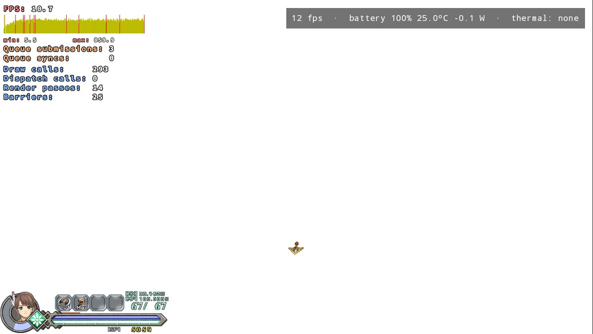
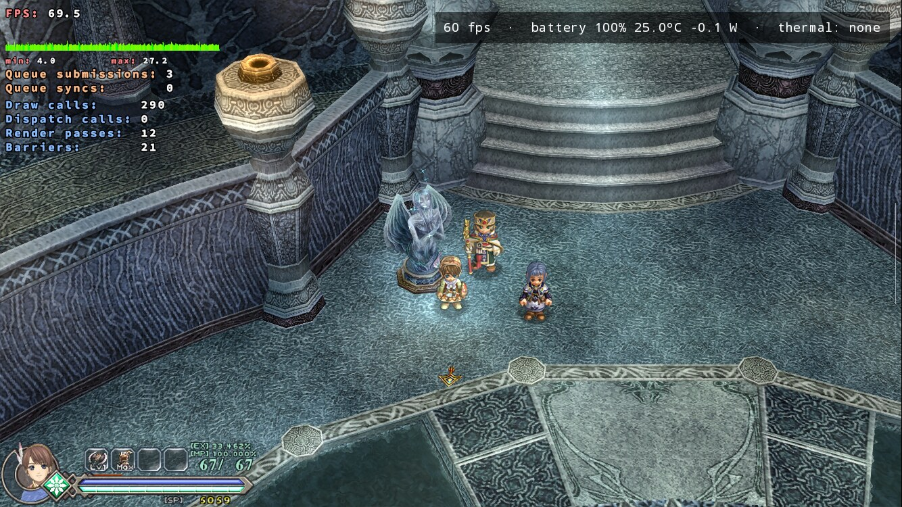
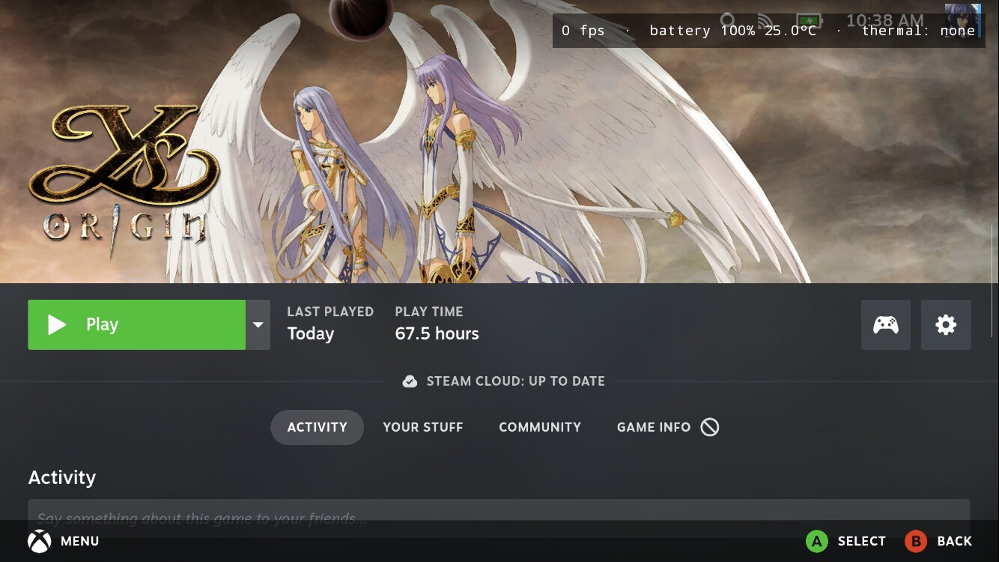
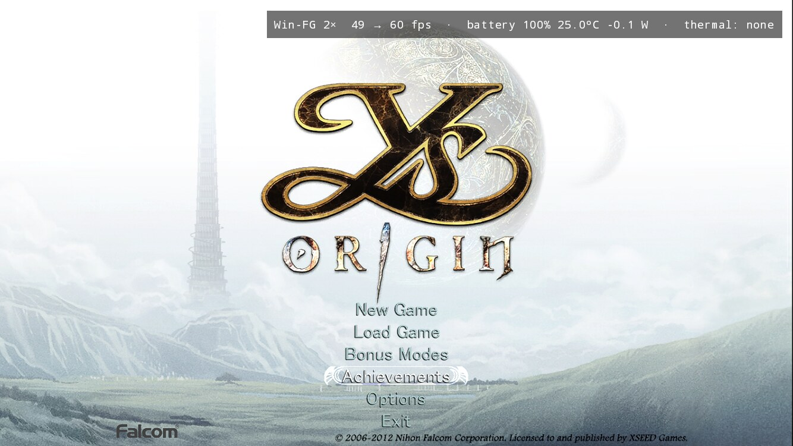
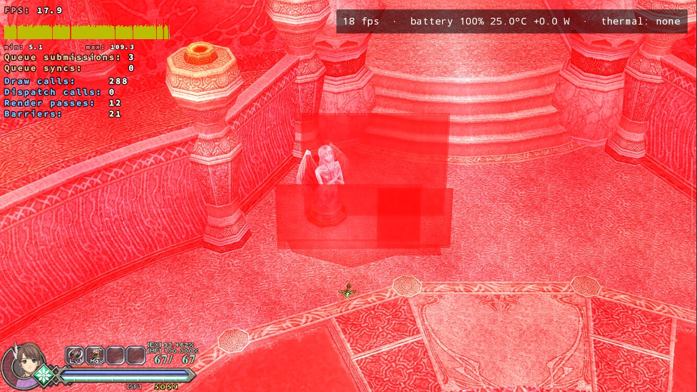
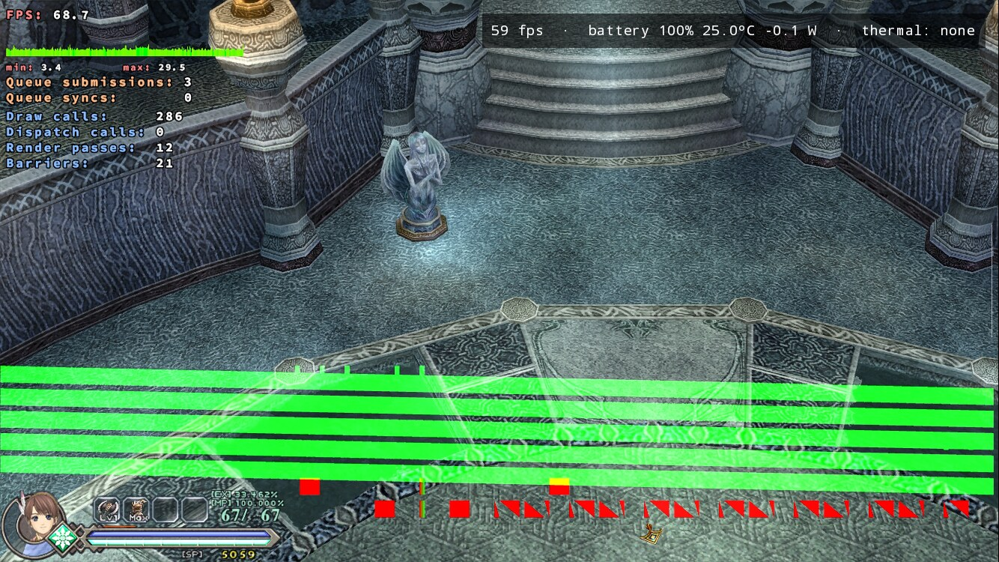
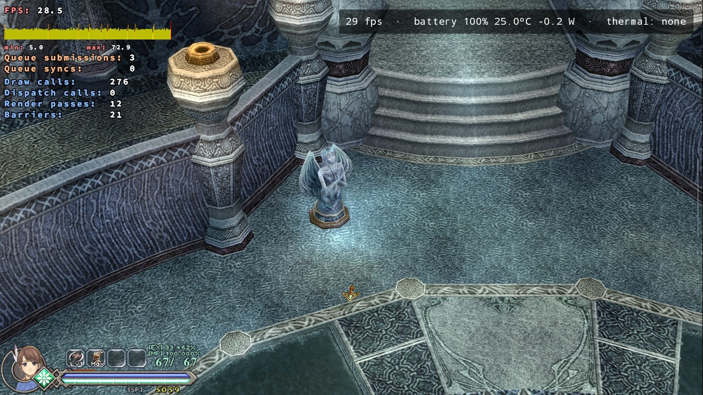

# DroidDeck Mali for the Retroid Pocket 4 Pro

yujikaido's fixed builds of [DroidDeck Mali](https://github.com/ASEbrahim/MaliBridge) (DroidDeck + MaliBridge) for the
**Retroid Pocket 4 Pro** (MediaTek Dimensity 1100, Mali-G77 MC9, Android 13, Arm driver r32p1). The stock
v0.5.4 build does not start on this device and two games showed GPU bugs; this build fixes those. Everything
here is GPL-3.0, like the projects it is built from, and the fixes are being offered upstream.

Tested on one Retroid Pocket 4 Pro only. The fixes switch themselves on for the r32 Mali driver, so the build
is safe on other phones, but nothing else has been tested on them.

## What is fixed

| Problem on the stock v0.5.4 | Cause | Fix |
|---|---|---|
| Steam never starts: gamescope dies at once | Mali r32p1 refuses an image-format query with `MUTABLE_FORMAT_BIT` on dma-buf images; gamescope needs it for every flippable image | The bridge retries the query without the flag and answers that (MaliBridge `server_opaque.c`) |
| The whole bridge goes down, or images read back wrong | r32p1 crashes in `vkGetImageSubresourceLayout` on an unbound AHardwareBuffer image, and reports `rowPitch 0` for linear images on AHardwareBuffer pages | A plain "twin" image answers requirements and layouts; linear tiling is hidden under the AHardwareBuffer memory strategy |
| Games installed on the SD card hang at a black screen (Ys Origin) | Android mounts the SD card noexec; DroidDeck's noexec shim only covered FEX processes, not Wine's ARM64EC ones | The shim covers Wine's processes too (`tools/linuxfs/preload/noexec.c`) |
| **White rooms** in Ys Origin (any room with lighting effects, 12 fps) | The game keeps dead particles with NaN matrices in its draw list; a PC GPU drops them, r32p1 draws each as a sheet over the whole screen | New MaliBridge erratum `nan_position`: every vertex shader gets a guard that moves a NaN, Inf or zero-w position outside the clip volume |
| **Press Play twice**: the first launch with frame generation on crashes the app | The Win-FG engine destroys its images and resets its descriptor pool while a frame is still in flight, and reuses descriptor sets from a destroyed pool at the same frame size | Waits for the GPU before both teardowns; the scratch cache is dropped with its pool |

## Screenshots

Ys Origin, 1F Search Party's Base, before and after (the game's own DXVK HUD at the top left):

| Before: the white room, 12 fps | After: 69 fps |
|---|---|
|  |  |

Title screen at 61 fps from the SD card, and Win-FG 2x on the second launch in one session (49 real frames
to 60 on screen), which used to crash:

| Title | Win-FG second launch |
|---|---|
|  |  |

How the white room was found. The sprite pipeline's pixels drawn as translucent red show its draws covering
the whole screen (left). A diagnostic vertex shader then placed every draw in its own grid cell, green when
the vertex data it fetched was sane and red when large (middle): the data was fine, so the per-draw matrices
were the suspect, and a replay of the frame on the PC showed 154 of 208 sprite draws carrying NaN matrices.
With the pipeline's pixels discarded the room is correct (right), which is what the guard now achieves
without touching the game's own sprites.

| Sprite draws in red | Vertex data per draw | Sprite pixels discarded |
|---|---|---|
|  |  |  |

## Games tested

Retroid Pocket 4 Pro, fix13, Proton Experimental, default DroidDeck settings unless noted. Add a row for each
game you try; "Playable" means a full session without crashes or rendering faults.

| Game | Install | Status | FPS | Notes |
|---|---|---|---|---|
| Teenage Mutant Ninja Turtles: Shredder's Revenge | SD card | Playable | 60 average | D3D11 via DXVK, 1280x720, frame generation on; about 20 s black screen at start while shaders compile (normal) |
| Ys Origin | SD card | Playable | 60-69 in rooms, 61 title | D3D8 32-bit; white rooms fixed by `nan_position`; refractive floors 50-60; Win-FG 2x works |
| | | | | |
| | | | | |
| | | | | |

Status words: Playable / Playable with issues / Starts, not playable / Does not start. Please also say
whether the game is on internal storage or the SD card, and the frame-generation setting if it was on.

## Installing

`DroidDeck-MaliBridge-v0.5.4-rp4pro-fix13.apk` (on the [Releases](../../releases) page) is the stock v0.5.4 APK with three libraries replaced
(the bridge server, the compositor, and the Linux-side preload), signed with a **personal debug key**, not the
author's. Because of that:

- If you have the official DroidDeck Mali installed, **uninstall it first**. Android refuses to install over
  a different signature. You lose the app's settings and have to sign in to Steam again; your Steam library
  on the SD card stays.
- Updates from inside the app will offer the official builds, which will not install over this one either.
  When the fixes land upstream, uninstall this and go back to the official APK.

## What is inside

| Part | Built from |
|---|---|
| `lib/arm64-v8a/libvkbridge_server.so`, `libvkbridge_jni.so` | MaliBridge, branch `rp4pro-fixes` (4 commits on v0.5.4) |
| `lib/arm64-v8a/libdroiddeckwayland.so` | DroidDeck's compositor from the author's `mali-test-build` branch + `patches/compositor-fix7-fork-b3006a8a.patch` + `patches/compositor-fix13-winfg-waits.patch` |
| `assets/linuxfs/libblsession.so` | DroidDeck preload, branch `rp4pro-noexec-arm64ec` |

The patches in `patches/` apply to the fork's `app/src/main/cpp` tree; the same changes are committed on the
DroidDeck branches for `main`.

## Known limits

- Only the Win-FG frame-generation engine is available on this device: LSFG needs Vulkan 1.2 and the r32p1
  driver offers 1.1.
- Ys Origin's refractive floors cost about 10 ms a frame on this GPU; rooms with one run at 50-60 fps rather
  than 70.
- The `nan_position` erratum is switched on by driver version (r32). It needs a startup probe before it can
  be offered to every Mali.

## Repository layout

| Folder | Contents |
|---|---|
| `screenshots/` | the images above |
| `patches/` | the compositor and frame-generation patches against the `mali-test-build` fork |
| `tools/` | the Vulkan probes run inside the DroidDeck rootfs during the investigation (`vk*.py`), the apitrace frame replay (`ys_replay.py`), and the preload build / APK repack scripts |
| `docs/` | the pull-request write-ups sent upstream |

## Credits

**[yujikaido](https://github.com/yujikaido)** - owner of the Retroid Pocket 4 Pro these fixes were found and
tested on, and of this repository. Every build here went through many launch-test-rebuild rounds on that
device over several days; the before/after screenshots are from those sessions. Questions about this build
and reports from other RP4 Pro owners go to this repository's Issues.

[ASEbrahim](https://github.com/ASEbrahim) for MaliBridge and DroidDeck Mali, and
[Droid-Deck](https://github.com/Droid-Deck/DroidDeck) for DroidDeck, which this build is made from.

The debugging itself (probes, shader bisection, the apitrace replay and the patches) was done with Claude
(Anthropic) driving the device over adb under yujikaido's direction; the write-ups are in the pull requests.
